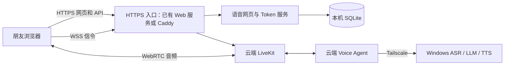

# 云端应用与本地模型部署方案

状态：方案已确认，部署脚本与配置已制作，尚未部署 · 2026-10-24

应用部署在 Ubuntu 云服务器，通过 Tailscale 访问本地 Windows 模型。HTTPS 入口可替换，LiteSpeed 不是应用依赖：已有 Web 服务时复用入口，没有时使用 Caddy。当前香港服务器只是临时承载实例，接入时保留其 LiteSpeed 和 PHP 应用。本方案单独维护，不修改原本地部署文档或启动器。决策见 [ADR 0011](../decisions/0011-cloud-app-local-models.md)，执行入口见 [deploy/cloud/README.md](../../deploy/cloud/README.md)。

## 部署结构

| 位置 | 运行内容 |
|---|---|
| Ubuntu 云服务器 | HTTPS 入口、网页静态文件、Token/邀请服务、SQLite、Voice Agent、LiveKit；已有其他应用时共存 |
| 本地 Windows | 原有 ASR、LLM、TTS 及模型数据；TTS 参考音频留在本地 |
| 朋友浏览器 | 访问公网网页并连接云端 LiveKit，不需要安装 Tailscale |

当前临时服务器已知配置：2 vCPU、4 GiB 内存、50 GiB 存储、200 Mbps 入/出速率限制、700 GiB 月流量。截图时内存已用约 1.9 GiB，这是历史瞬时值，不是通用部署规格。此机按与 PHP 共存评估容量，换机器后重新检查可用资源；3–5 人同时通话以实测为准。云端 Agent 自身仍有 VAD 推理开销，本地 TTS 也有排队限制。

## 域名与端口

使用两个应用专用子域名，下表仅用示例占位。若服务器已有站点，其域名、目录与服务继续保留。

| 入口 | 接法 |
|---|---|
| `voice.example.com` | HTTPS 入口提供构建后的网页；`/api/` 保留前缀代理到本机 Token 服务 8787，网页与 API 同源 |
| `rtc.example.com` | HTTPS 入口转发 HTTP/WebSocket 至本机 LiveKit 7880；不直接对公网开放 7880 |
| 音频 | 对公网开放 UDP 7882、TCP 7881；不经过普通 HTTP 反代 |
| 模型 | 云端 Agent 经 Tailscale 访问 Windows，不新增模型公网入口 |
| 数据库和内部授权 | SQLite 留在本机；内部接口不经公网虚拟主机暴露 |

入口按服务器现状二选一，应用服务和发布流程相同：

- 已有 Web 服务：复用其 80/443 入口，仅新增应用域名。当前服务器使用 [LiteSpeed 模板](../../deploy/cloud/litespeed/README.md)，保留 PHP 站；已有 Nginx、Apache 等也可按上述路由接入，无需额外安装 LiteSpeed。
- 没有 Web 服务：使用 [Caddy 配置](../../deploy/cloud/caddy/README.md)承载静态网页、API 和 WSS，并管理 HTTPS 证书。先确认 80/443 空闲，再安装和启用。Caddy 原生支持 WebSocket 反代。[Caddy 文档](https://caddyserver.com/docs/caddyfile/directives/reverse_proxy)

首期不提供 TURN/TLS 443 回退，接受部分公司网络或 VPN 无法通话。不开第二公网 IP、不加四层分流；同一地址的 80/443 由选定的一个 Web 入口管理。家庭 Wi-Fi 和手机流量列入上线验证。[LiveKit 端口说明](https://docs.livekit.io/transport/self-hosting/ports-firewall/)

## 启动与配置

使用 systemd 分别管理 Token 服务、Voice Agent 和 LiveKit；网页由选定的 Web 服务直接提供，不使用 Vite preview。新增云端配置集中到 `deploy/cloud/`，原 `pnpm app` 本地方式保留。

- Node.js 至少 22.13，pnpm 10.18；固定经过验证的运行版本。依赖在兼容目标 Ubuntu 架构的环境安装，不能复制 Windows 的 `node_modules`。
- 应用、配置和持久数据使用独立目录及专用用户。SQLite 放在版本目录之外，正常重启、更新不删除数据。
- 角色定义与预录 fillers 随应用交付；不迁移模型权重。打包使用目录，不要求读取真实角色内容。
- LiveKit 使用正式密钥和生产配置，不运行 `--dev`。

| 配置 | 云端用途 |
|---|---|
| `APP_ORIGIN` | 网页实际 HTTPS 来源，与 Cookie/来源检查一致 |
| `INVITE_DB_PATH` | 指向独立持久目录下的 SQLite 文件 |
| `ACCESS_INTERNAL_URL` | Agent 到本机 Token 服务的内部地址 |
| `ACCESS_INTERNAL_SECRET` | 可使用独立内部鉴权密钥，不写入仓库 |
| `ACCESS_TRUSTED_PROXY_IPS` | 只信任所选 Web 代理的实际回环来源 IP，不使用任意来源白名单 |
| `LIVEKIT_URL` / `LIVEKIT_PUBLIC_URL` | 分别用于应用内部连接和浏览器 WSS 地址 |
| `ASR_URL` / `LLM_BASE_URL` / `TTS_FASTAPI_URL` | Windows 的 Tailscale 模型地址；TTS 使用 FastAPI 后端 |
| `CHARACTERS_DIR` / `FILLERS_DIR` | 云端角色及预录音频资源目录 |

公网 API 与内部准入接口须按路由隔离；不能将 Token 服务的所有路径原样公开代理。模型端口的私网访问范围限定到所需设备。Tailscale 直连/中继状况与完整模型调用延迟在部署时验证。[Tailscale 文档](https://tailscale.com/docs/reference/troubleshooting/network-configuration/derp-routing)

## 日常使用与更新

- 模型离线时网页及邀请码验证继续可用，通话入口提示模型暂不可用；不排队、不自动唤醒电脑、不切换付费云模型。
- 更新允许短时维护：停止接收新通话，等待已有拨号和通话结束，再更新并重启应用服务。已有其他应用时不改动其服务。
- 使用版本目录保留上一版应用；持久数据与版本目录分开。回退代码时检查数据库兼容性，不覆盖或清空现有数据库。
- 不建设备份、对象存储、灾难恢复、无停机集群或额外运维平台。这覆盖此前的每日备份建议；不再约定 24 小时数据恢复目标。

持久化及正常进程重启后的通话占用对账仍按 ADR 0010 实现；它们不属于本次排除的备份或灾难恢复。模型离线展示、SQLite 维护状态及内部运维接口已补充实现。云配置启用模型检查，普通本地配置默认关闭；只有新数据库采用配置中的维护初值，重启沿用持久值。

## 执行顺序与验收

1. 只读核对 Ubuntu/CPU 架构、现有 Web 服务和监听、实际子域名及 Tailscale 地址。选择复用入口或空闲端口上的 Caddy；不要求预装 LiteSpeed。
2. 准备应用目录、Linux 依赖、角色/fillers 资源和 SQLite 持久目录；设置生产配置及 systemd 服务。
3. 配置所选入口的两个域名、证书和 HTTP/WebSocket 反代；开放语音媒体端口，有旧站时检查其仍正常。
4. 验证邀请码进入、固定角色链接、真实通话、字幕、挂断、重连和单码单通话；覆盖家庭 Wi-Fi 与手机流量。
5. 验证模型离线提示、恢复可用、维护时拒绝新通话及已有通话结束后更新；逐步测试 1、3、5 路通话，同时观察云端资源、本地模型排队及已有其他应用的响应。

本方案已定稿；实际版本、地址和证书路径在部署前核验后填写。`deploy/cloud/` 已提供配置生成、安装、资源同步、排空发布、运维工具及三个 systemd 单元；入口提供独立 Caddy 配置，以及已有 OpenLiteSpeed / Enterprise 的接入模板。未连接或更改服务器，未在公网安装/启动服务，也未完成云端媒体与容量验收。
