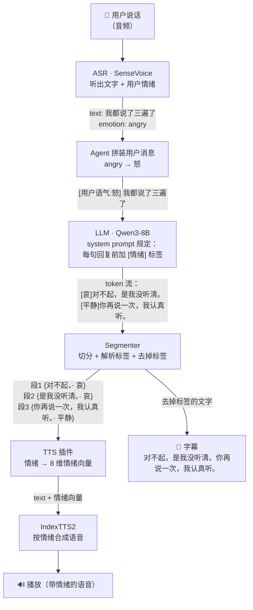
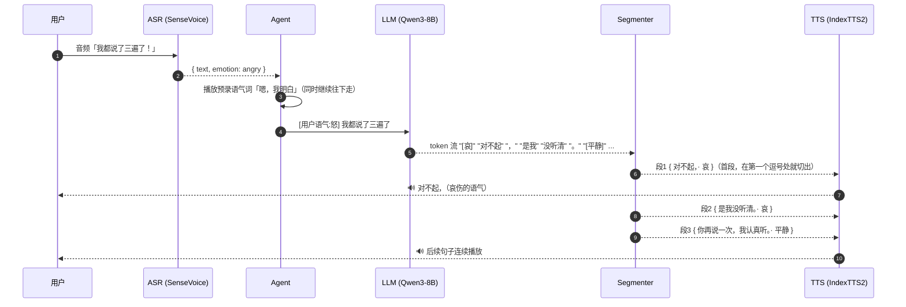

# 情绪链路

> 版本：1.1 · 日期：2026-10-23 · 对应工单：#4 Segmenter、#13 情绪链路端到端 · 决策：ADR 0004

## 一句话

ASR 先听出**用户**的情绪，作为提示交给 LLM；LLM 在**自己的**每句回复前加一个情绪标签；Segmenter 把标签解析出来，并从文字中去掉；TTS 按这个情绪合成语音；字幕只显示干净的文字。

## 流程图

## 一轮对话的时序

时序上的关键点：Segmenter 不用等 LLM 把整段回复说完，切出一段就交给 TTS 一段。第一段特意切得很短，用来缩短首句延迟（见 ADR 0006）。

## 标签约定

**用户情绪（输入给 LLM）**：Agent 把 SenseVoice 的情绪类别映射成中文，加在用户消息前面，格式为 `[用户语气:X]`。

| SenseVoice | 映射为 |
|---|---|
| HAPPY | 喜 |
| ANGRY | 怒 |
| SAD | 哀 |
| FEARFUL | 惧 |
| DISGUSTED | 厌恶 |
| SURPRISED | 惊喜 |
| NEUTRAL / 未识别 | 平静 |

实现（#13，`apps/agent/src/emotion/user-tone.ts`）：

- **平静不加前缀**。SenseVoice 绝大多数句子判为 NEUTRAL，每轮都带 `[用户语气:平静]` 只是上下文噪音；只有非平静时才写 `[用户语气:X] 原文`。
- **一轮取最后一个非平静的句子**。一轮可能由几段 VAD 语音拼成；任一段带情绪就用它（最后出现的优先）。
- **只加在正在回答的那条消息上，而且只加在发给 LLM 的副本里**（`CharacterAgent.llmNode`）。对话历史、用户字幕、`turn timing` 的 `user` 字段都是原文，之前几轮发给 LLM 时也没有前缀。不在 `onUserTurnCompleted` 里改消息，是因为框架的抢先生成（preemptive generation）会比对原文，改了就会作废、重新生成。按文本而不是按时序找本轮的情绪：LLM 请求可能在一轮结束前（抢先生成）就发出。

**回复情绪（LLM 输出）**：每句话前加 `[情绪]`，只能从这 8 个里选：喜、怒、哀、惧、厌恶、低落、惊喜、平静。它们和 IndexTTS2 的 8 维情绪向量一一对应（顺序 0–7 就是这个排列）。

**system prompt 里的规则**：最终版本在 `apps/agent/prompts/character.md` 的“情绪标签”一节（迭代过程和遵守率见下文“实测”）。要点：每个以。！？结尾的句子前都要有标签，第二、三句也不能省；两条格式示例；示例只演示格式、不要照搬；`[用户语气:X]` 是对方的语气，不要复述；对方生气时用 [哀] / [平静] 安抚，不要用 [怒]。

注意，用户生气时 AI 不一定也要生气，通常应该用安抚的语气（哀、平静）回应。这由 prompt 和角色设定来决定，代码不做强制映射。

## TTS：情绪 → IndexTTS2 情绪向量

`TTS_EMOTION_CONTROL=vector`（默认）：每段按自己的情绪发 `/gen_single`，`emo_control_method='使用情感向量控制'`，`vec1..vec8` 是 one-hot（顺序同上表），`emo_weight=TTS_EMO_WEIGHT`（默认 0.8）。**平静的段落用“与音色参考音频相同”**，也就是参考音频本来的声音；这样大部分句子听起来和改动前一样，情绪只在需要的句子上出现。`TTS_EMOTION_CONTROL=reference` 恢复旧行为（所有句子都跟随参考音频）。

WebUI 对向量的处理（上游 IndexTTS2 的做法；这台 WebUI 是改过的版本，没有逐行核对）：各维乘一个偏置（喜 0.94、怒 0.88、哀/惧 1.0、厌恶/低落 0.94、惊喜 0.69、平静 0.56），总和超过 0.8 就缩到 0.8，再乘 `emo_weight`。所以 one-hot 1.0、`emo_weight=0.8` 时，实际情绪权重约 0.55–0.64，其余部分保持参考音频的说话风格。

`emo_weight` 的选择（2026-10-23，Mac 经 Wi-Fi 调 Windows WebUI；同一句中性内容“我知道了，那我们明天再说吧。”，再用 SenseVoice 回听分类、同时看识别文本有没有错）：

| emo_weight | 喜 | 怒 | 哀 | 惊喜 | 说明 |
|---|---|---|---|---|---|
| 参考音频 | — | — | — | — | 3.0s 音频，SenseVoice 判 HAPPY（参考音频本身偏轻快） |
| 0.65（WebUI 默认） | HAPPY | NEUTRAL | NEUTRAL，3.8s | HAPPY | 怒几乎听不出来 |
| **0.8（选用）** | HAPPY | ANGRY | NEUTRAL，4.3s（语速明显放慢），开头多出一个“哼” | HAPPY | 情绪可辨，字都对 |
| 1.0 | HAPPY | ANGRY，但“知道”被识别成“吃头” | 3.9s | ANGRY（判错） | 开始吐字不清 |

SenseVoice 对“哀”不敏感，只能从语速变慢看出变化；“哀”和“低落”的效果、0.8 下偶发的多余语气音，需要人耳确认（见下文）。

**延迟**：情绪向量不增加合成耗时。同一句分别用参考音频和向量合成（4 句交替，9–16 字）：参考音频 1.70–2.23s（平均 1.89s），向量 1.72–2.16s（平均 2.02s），实时率 0.62–0.79 两者相同；向量模式平均多出的 0.13s 来自“哀”的语速更慢、音频更长（同一句 2.3s → 3.0s）。真实通话里首段（3–9 字）`ttsFirstMs` 1.3–2.0s，`totalMs` 2.4–3.2s，与 #11 的 2.5–3.5s 一致（同样是 Mac 经 Wi-Fi，只看比例）。

## 实测（#13）

### 标签遵守率（Qwen3-8B Q5_K_M，llama-server，thinking off，temperature 0.7）

`pnpm --filter @ptoy/agent emotion:compliance -- --runs 2`（`apps/agent/scripts/emotion-compliance.ts`）：5 通脚本对话 × 4 轮，用户情绪有平静、怒、哀、喜、惊喜、惧、厌恶，并在通话中途变化；请求和真实通话一样带 `[用户语气:X]`，模型自己的历史回复是 Segmenter 去掉标签后的文本。改 prompt 后重跑这个脚本比较。

| prompt 版本 | 回复数 | 每句都有标签的回复 | 有标签的句子 | 首句有标签 | 非法标签 / 复述用户语气 |
|---|---|---|---|---|---|
| v1：草案规则放在角色设定后面 | 20 | 4（20%），第 3、4 轮 0/5 | 24/44（55%） | 20/20 | 1（`[关心]`）/ 0 |
| v3：强调“第二、三句也不能省”+ 具体示例 | 40 | 36（90%） | 86/90（96%） | 40/40 | 0 / 0；但有 3 次照抄示例原句 |
| v4：示例换成占位符 `[情绪]第一句话。` | 40 | 25（63%），回复变长 | 100/116（86%） | 40/40 | 2 / 0 |
| **v5（采用）**：两条与常见话题无关的具体示例 +“只演示格式，不要照搬” | 40 | **36（90%）**，按轮次 10/9/10/7 | **79/83（95%）** | **40/40** | **0 / 0**，没有照抄 |

漏标签的情况几乎都是同一个模式：首句有标签，后面紧跟的一句没有（如 `[喜]太好了！旅游能放松心情。[平静]你打算去哪里呀？` 中的第二句）。按规则这句用平静（参考音频），听起来自然，不算故障。多轮下来遵守率没有明显下降：历史里没有标签不影响模型继续输出。

v5 各种用户语气下回复各段的情绪（40 条回复）：平静 → 平静 21、喜 18、低落 1；怒 → 哀 8、平静 6、怒 3；哀 → 哀 8、平静 6；喜 → 喜 6、平静 6、惊喜 2；惧 / 厌恶 → 哀和平静。40 条里每条都用了不止一种情绪（通常是“情绪句 + 平静的追问”）。用户生气时模型多数用哀/平静安抚，偶尔用 [怒] 表示“替你生气”（如“真让人火大”），可以接受。

### 端到端

- `sim:call --fake asr,llm,tts --emotions "neutral|angry|happy"`：假 LLM 每轮回复里有按句的标签、一个拆在两个 token 里的标签、一个非法标签 `[开心]`。检查每个 LLM 请求里被回答的用户消息带对应的 `[用户语气:X]`（平静没有）、历史消息没有前缀也没有标签；每段 TTS 请求的情绪向量与标签一致（非法标签那句用参考音频）；字幕与去掉标签的回复逐字相同。故意去掉 `llmNode` 里的前缀时这项检查会失败。
- 真实 ASR + LLM + TTS（`say -v Ting-Ting` 说 4 句带情绪的话）：SenseVoice 把这 4 句全部判成 NEUTRAL（合成语音没有情绪起伏），所以真实 ASR 下没有出现前缀；回复仍然每轮都带标签（如用户说“我都说了三遍了”→ `哀 对不起，/ 哀 我可能没听清楚。/ 平静 你再重复一遍好吗？`）。
- 真实 LLM + TTS、假 ASR 给情绪（`--fake asr --emotions "neutral|angry|angry|happy|sad"`）：怒 → “对不起，我刚才没注意听”（哀、哀、平静）、“我错了，别生气嘛”（哀、哀、平静）；喜 → “太好了！”（喜）；哀 → “我懂，工作压力好大”（哀、哀、平静）。抢先生成每轮都被采用（“using preemptive generation”），加前缀没有让它作废。

### 需要人耳确认

用 `pnpm app` 真人打电话：生气地说一句、开心地说一句，听 AI 回复的语气能否区分（验收标准 1）；“哀”句子是否太慢、`emo_weight=0.8` 时偶发的多余语气音（如句首的“哼”）是否可接受；平静句（参考音频）和情绪句接在一起时音色是否跳变。觉得情绪太弱或太强，调 `TTS_EMO_WEIGHT`（0.65–0.9 之间），不用改代码。真人麦克风下 SenseVoice 能否识别出生气/开心，看 Agent 的 `user utterance` debug 日志里的 `emotion` 和 `user tone for the llm`。

## 出错时怎么办

| 情况 | 处理 |
|---|---|
| LLM 忘了加标签 | 沿用上一句的情绪；回复第一句没有标签时按“平静”处理 |
| 标签写错，比如 `[开心]` | 丢掉标签，按上一行同样处理 |
| 标签被拆在两个 token 里，比如 `[厌` + `恶]` | Segmenter 会拼起来再解析 |
| 回复结束时残留半个标签 | 丢掉 |
| 模型在首句后漏写标签（最常见；换成更口语的角色设定后约 10–30% 的句子） | 沿用上一句的情绪（Segmenter `emotionScope: "untilNextTag"`，2026-10-24 起）。漏写的几乎都是同一情绪的后续句，按平静合成会和前一句的语气断开 |
| 任何情况下 | 字幕和 TTS 文本里都不会出现标签，链路不会因为格式问题中断（`sim:call --fake` 每轮检查） |

## 为什么用固定标签，而不是让 LLM 写一段“语气描述”

IndexTTS2 也支持“情感描述文本”模式，比如传入“温柔地、带点歉意地说”。我们没有选这种方式，原因有三点：

1. **可控**：标签只有 8 种，解析结果是确定的；自由描述则需要 IndexTTS2 再用一个模型把文字转成情绪向量，结果不稳定，也多一步计算。
2. **快**：一个标签只有 2–4 个 token；一段描述要十几个 token，会直接增加首句延迟。
3. **好兜底**：标签缺失或写错时按“平静”处理就行；描述写得含糊，很难判断该怎么处理。

如果以后发现 8 种情绪不够细，可以再引入“情绪强度”（向量权重），比如 `[哀:0.3]`。这不需要改变整个链路的结构。
