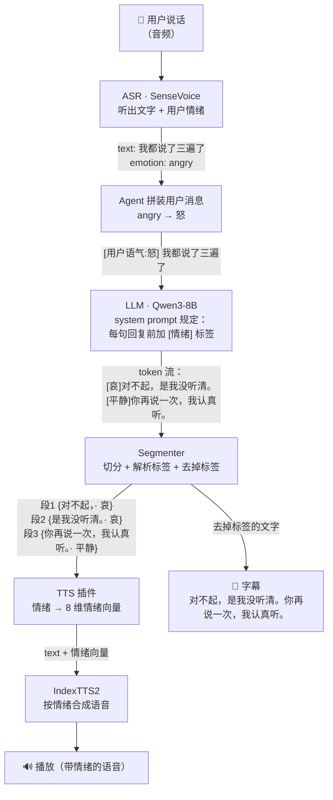
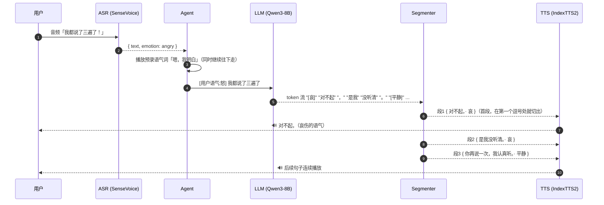

# 情绪链路

> 版本：1.0 · 日期：2026-10-23 · 对应工单：#4 Segmenter、#13 情绪链路端到端 · 决策：ADR 0004

## 一句话

ASR 先听出**用户**的情绪，作为提示交给 LLM；LLM 在**自己的**每句回复前加一个情绪标签；Segmenter 把标签解析出来，并从文字中去掉；TTS 按这个情绪合成语音；字幕只显示干净的文字。

## 流程图

## 一轮对话的时序

时序上的关键点：Segmenter 不用等 LLM 把整段回复说完，切出一段就交给 TTS 一段。第一段特意切得很短，用来缩短首句延迟（见 ADR 0006）。

## 标签约定

**用户情绪（输入给 LLM）**：Agent 把 SenseVoice 的情绪类别映射成中文，加在用户消息前面，格式为 `[用户语气:X]`。

| SenseVoice | 映射为 |
|---|---|
| HAPPY | 喜 |
| ANGRY | 怒 |
| SAD | 哀 |
| FEARFUL | 惧 |
| DISGUSTED | 厌恶 |
| SURPRISED | 惊喜 |
| NEUTRAL / 未识别 | 平静 |

**回复情绪（LLM 输出）**：每句话前加 `[情绪]`，只能从这 8 个里选：喜、怒、哀、惧、厌恶、低落、惊喜、平静。它们和 IndexTTS2 的 8 维情绪向量一一对应（顺序 0–7 就是这个排列）。

**system prompt 里的规则（草案）**：

> 你的每一句话都必须以情绪标签开头，标签只能是 [喜] [怒] [哀] [惧] [厌恶] [低落] [惊喜] [平静] 之一。用户消息前的 [用户语气:X] 是对方说话时的语气，请据此调整你的回应态度，但不要复述这个标签。

注意，用户生气时 AI 不一定也要生气，通常应该用安抚的语气（哀、平静）回应。这由 prompt 和角色设定来决定，代码不做强制映射。

## 出错时怎么办

| 情况 | 处理 |
|---|---|
| LLM 忘了加标签 | 这句按“平静”处理 |
| 标签写错，比如 `[开心]` | 丢掉标签，这句按“平静”处理 |
| 标签被拆在两个 token 里，比如 `[厌` + `恶]` | Segmenter 会拼起来再解析 |
| 回复结束时残留半个标签 | 丢掉 |
| 任何情况下 | 字幕和 TTS 文本里都不会出现标签，链路不会因为格式问题中断 |

## 为什么用固定标签，而不是让 LLM 写一段“语气描述”

IndexTTS2 也支持“情感描述文本”模式，比如传入“温柔地、带点歉意地说”。我们没有选这种方式，原因有三点：

1. **可控**：标签只有 8 种，解析结果是确定的；自由描述则需要 IndexTTS2 再用一个模型把文字转成情绪向量，结果不稳定，也多一步计算。
2. **快**：一个标签只有 2–4 个 token；一段描述要十几个 token，会直接增加首句延迟。
3. **好兜底**：标签缺失或写错时按“平静”处理就行；描述写得含糊，很难判断该怎么处理。

如果以后发现 8 种情绪不够细，可以再引入“情绪强度”（向量权重），比如 `[哀:0.3]`。这不需要改变整个链路的结构。
